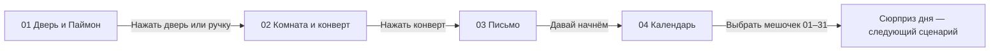
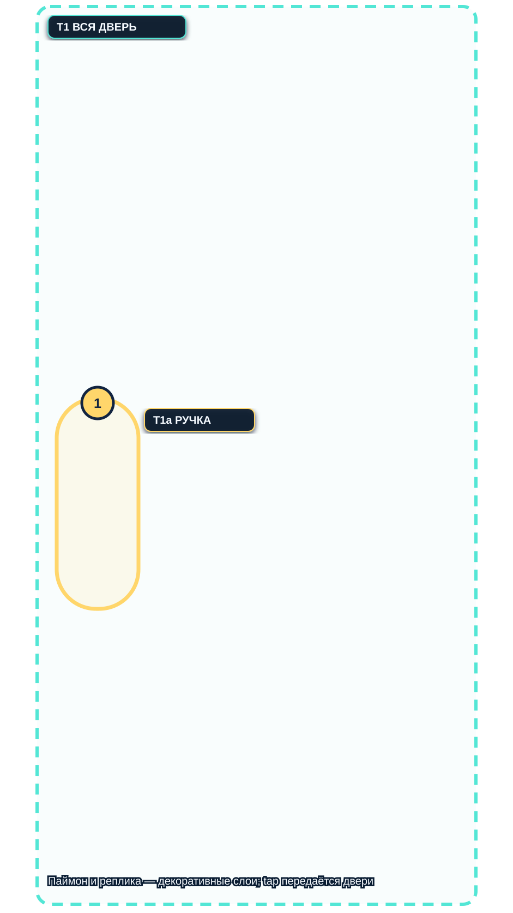
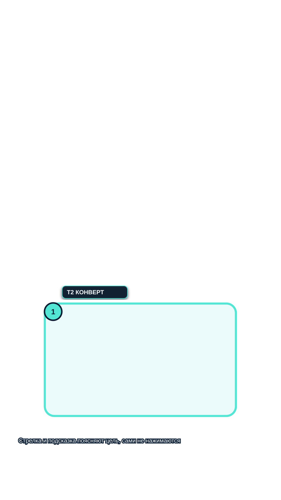
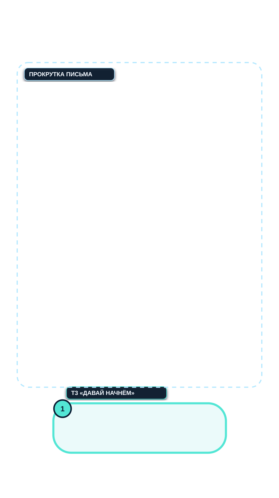
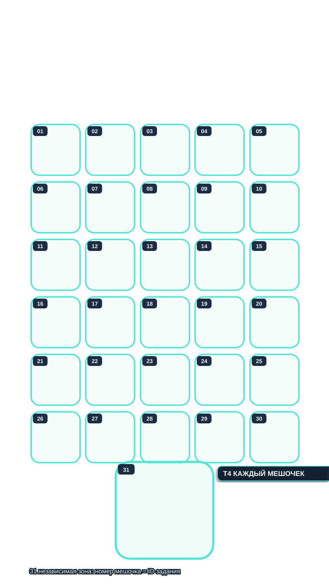

# Новогодний адвент-календарь — дизайн-пакет

Версия для передачи в дизайн и дальнейшую сборку. Основа — четыре выбранных концепт-экрана в холодной палитре Genshin Impact.

## Формат и адаптация

- Единственный интерфейсный формат — вертикальный мобильный холст 9:16.
- Базовый логический артборд: 390 × 693 px. Сцены и расположение элементов не перестраиваются на больших дисплеях.
- На широком экране артборд масштабируется пропорционально и центрируется: `scale = min(ширина экрана / 390, высота экрана / 693)`.
- Пустые поля вокруг холста заполняются продолжением или мягким размытием фона текущей сцены. Новые desktop-панели, колонки и навигация не добавляются.
- На телефонах с более высоким экраном сохраняется артборд 9:16; дополнительная высота заполняется фоном сцены. Интерактивные зоны остаются внутри центрального холста.
- Для реального интерфейса тексты, кнопки, номера и зоны нажатия должны быть отдельными слоями. Текущие PNG — растровые концепт-композиты размером 941 × 1672 px.

| Пример окна просмотра | Масштаб | Результат |
|---|---:|---|
| 320 × 568 px | 0.82× | Мобильный холст уменьшается целиком, без перестановки элементов. |
| 390 × 844 px | 1.00× | Холст остаётся 390 × 693 px; дополнительная высота заполняется атмосферным фоном сцены. |
| 1440 × 900 px | 1.30× | Холст вырастает примерно до 507 × 900 px и центрируется; desktop-layout не появляется. |

Формула для вертикального окна: `scale = min(W / 390, H / 693)`. Концепт-иллюстрации имеют разрешение 941 × 1672 px, поэтому для масштабов выше примерно 2.4× отдельные production-слои следует экспортировать в большем разрешении.

## Путь пользователя

Последний переход ведёт в контент дня, который не входит в утверждённые четыре экрана. Тип контента (загадка, подарок, головоломка) и его экран нужно спроектировать отдельно.

## 01. Дверь и Паймон

| ID | Элемент | Поведение |
|---|---|---|
| T1 | Вся видимая дверь | Нажатие в любом месте двери переводит на экран 02. |
| T1a | Ручка — приоритетная область | Та же команда, что у T1. Свечение и подсказка показывают рекомендуемую точку нажатия. |
| V1 | Паймон и облачко реплики | Визуальный проводник; не отдельная кнопка. Нажатие на персонажа или облачко передаётся зоне двери. |
| V2 | Подсказка «Нажми на ручку» | Подпись к действию; не отдельная кнопка. |

**Состояние при входе:** Паймон приветствует пользователя; ручка мягко мерцает. **Результат нажатия:** короткая анимация ручки/двери, затем переход в комнату. Анимация — предлагаемое поведение для сборки.

## 02. Комната и конверт

| ID | Элемент | Поведение |
|---|---|---|
| T2 | Конверт на столе | Основная зона нажатия. При нажатии открывается письмо на экране 03. |
| V3 | Подсказка «Нажми на конверт» и световая стрелка | Направляют взгляд на конверт; декоративные, не самостоятельные кнопки. |
| V4 | Камин, ёлка, окно, подарки | Декоративная сцена. |

**Обратное действие:** возврат на экран 01 отдельной кнопкой в выбранном макете не показан; системный жест «назад» можно использовать как проектный fallback.

## 03. Письмо

| ID | Элемент | Поведение |
|---|---|---|
| T3 | Кнопка «Давай начнём» | Закрывает письмо и переводит на экран 04. Минимальная высота hit-area — 48 px на базовом артборде. |
| V5 | Текст письма | Нередактируемый текст. Если доступной высоты недостаточно, прокручивается карточка письма, а CTA остаётся закреплённой снизу. |
| V6 | Размытая комната и пергамент | Слой фона/карточки; вне CTA не нажимается. |

**Текст письма:** «Дорогой друг! Декабрь уже стучится в дверь, и каждый день приближает нас к самому волшебному празднику года. Чтобы ожидание было ярким и нескучным, я приготовил для тебя сюрпризы, загадки и головоломки. Ты уже догадался? Это адвент-календарь — целый месяц маленьких чудес! Ну что, начнём? Твой Дед Мороз».

## 04. Календарь

| ID | Элемент | Поведение |
|---|---|---|
| T4-01 … T4-30 | Мешочки 1–30 | Каждый мешочек — независимая зона нажатия; номер однозначно задаёт ID дня. |
| T4-31 | Большой мешочек 31 | Открывает сюрприз последнего дня. |
| V7 | Заголовок, фон, рамка, герои | Неинтерактивное оформление. |

**Состояния мешочка (предложение):** закрыт; доступен сегодня; выполнен. Правило открытия по дате и возможность повторно проходить прошедшие дни пока не заданы — определить перед разработкой. На карте все мешочки показаны как потенциальные hit-area; блокировка будущих дат должна быть отдельным состоянием, а не частью фоновой иллюстрации.

## Поведение и доступность

- Каждая зона имеет один явный результат и отдельный ID из карты.
- Минимальная цель нажатия — 44 × 44 px; кнопка письма — не менее 48 px по высоте.
- На экранах 01–03 переход запускается и касанием, и клавиатурным Enter/Space при наличии доступной фокусировки.
- Тексты из композитных макетов нужно перенести в живые текстовые слои. Это позволит масштабировать шрифт, локализовать строки и озвучивать их средствами доступности.
- Декоративная анимация (снег, мерцание, свечение) не должна перехватывать нажатия.

### Координаты основных hit-area

Координаты заданы в процентах от базового мобильного холста 9:16, начиная с левого верхнего угла. Это стартовые границы для реализации; иллюстрации и безопасные зоны уточняются на целевых устройствах.

| ID | X | Y | Ширина | Высота |
|---|---:|---:|---:|---:|
| T1 — дверь | 7% | 1% | 86% | 98% |
| T1a — ручка | 11% | 44% | 16% | 23% |
| T2 — конверт | 16% | 61% | 68% | 23% |
| T3 — CTA письма | 19% | 81% | 62% | 10% |
| T4-01 … T4-30 — один мешочек | 9.5% | по сетке | 15% | 8.7% |
| T4-31 — последний мешочек | 35% | 79% | 30% | 17% |

Для T4-01 … T4-30 сетка имеет 5 колонок и 6 рядов; шаг по X — около 16.6%, шаг по Y — около 9.8%. Каждая зона остаётся отдельной, даже если мешочки собраны в один визуальный компонент.

## Палитра и визуальные роли

| Токен | Роль |
|---|---|
| Ледяной голубой | Основной фон, снег, холодный свет |
| Глубокий сапфир | Панели, тёмные участки, фон календаря |
| Бирюза | Магические акценты и цвет воска/лент |
| Молочно-белый | Письмо, снег, текстовые подложки |
| Тёплое золото | Контуры, подсветка целей, орнамент |
| Янтарный | Камин и уютный контраст |

## Каталог ассетов

| ID | Файл | Использование | Статус |
|---|---|---|---|
| A01 | `assets/screen-01-door-paimon.png` | Экран 01: дверь, венок, Паймон, реплика и подсказка | Концепт-композит, 941 × 1672 |
| A02 | `assets/screen-02-room-envelope.png` | Экран 02: интерьер, ёлка, камин, конверт | Концепт-композит, 941 × 1672 |
| A03 | `assets/screen-03-letter.png` | Экран 03: размытый интерьер, карточка письма и CTA | Концепт-композит, 941 × 1672 |
| A04 | `assets/screen-04-advent-calendar.png` | Экран 04: календарь, 31 мешочек и герои | Концепт-композит, 941 × 1672 |

### Что отделить для production

Текущие четыре изображения — цельные растровые эскизы, а не многослойные production-ассеты. Для сборки следует подготовить отдельные слои:

- **Экран 01:** зимний фон/дверь, венок, Паймон с прозрачностью, живая реплика, подсказка, ручка/свечение, слой снега.
- **Экран 02:** интерьерный фон, конверт отдельным объектом, световая стрелка/эффект, живая подсказка.
- **Экран 03:** размытый фон, карточка пергамента, декоративные ленты, живой текст письма, кнопка.
- **Экран 04:** фон/рамка, один переиспользуемый спрайт мешочка, живые номера и состояния, отдельные иллюстрации Паймон/Люмин/Итэра.

Номера, текст, кнопки и состояния не следует оставлять запечёнными в финальном фоне. Для персонажей нужны отдельные иллюстрации и согласование прав на использование игровых персонажей перед публикацией.
